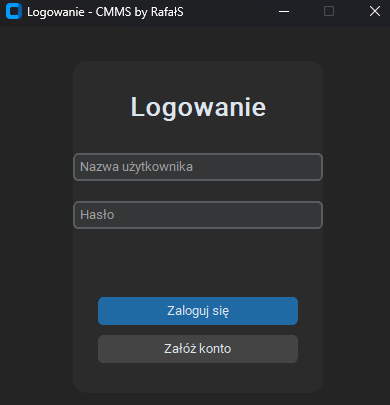
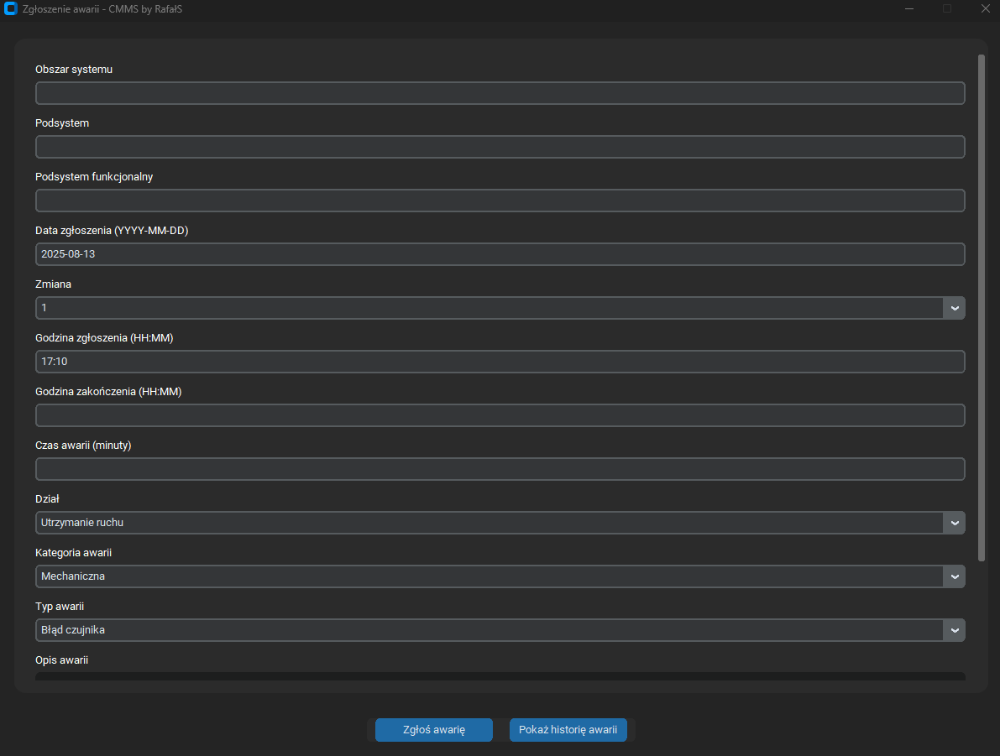
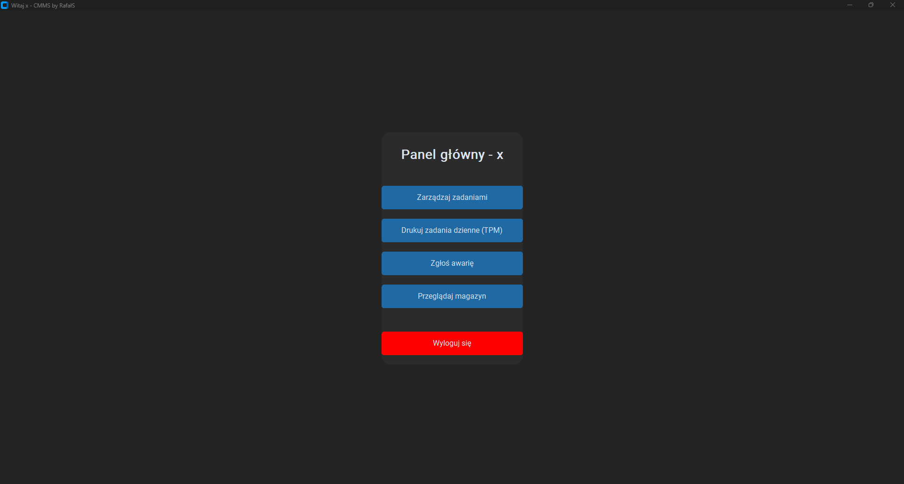

# CMMS

**CMMS** is a desktop **Computerized Maintenance Management System** written in Python. It supports maintenance work in industrial plants: task scheduling, failure reporting, spare parts inventory and failure statistics, all in one application.

---

## Features

### User authentication and roles
- Login and account creation.
- Role-based access to system functions: Administrator, Kierownik (Manager), Użytkownik (User) and Technik (Technician), see [Roles and permissions](#roles-and-permissions).
- Dark-themed interface.

### TPM task management
- Create, edit and track **Total Productive Maintenance (TPM)** tasks.
- Each task stores the date, interval, department, task type and description.
- Table-based overview with quick editing and a printable task list.

### Failure reporting
- Users report a failure with its area, subsystem, functional subsystem, date, shift, department, category, type and description.
- Failures go through three statuses: **Zgłoszona**, **W naprawie**, **Rozwiązana**. Technicians take over a reported failure and close it; downtime and repair costs are calculated when it is closed.
- Failure history with a status for every entry.

### Inventory
- Search spare parts by name or SAP number.
- The part used in a repair is added to the failure and included in its cost.

### Statistics and printed reports
- Dashboard with KPIs, Pareto chart by machine, monthly downtime and costs.
- The manager can print or save a PDF report for a chosen month, either for all machines or for a single machine: key indicators, four charts and a full list of failures.

---

## Roles and permissions

| Role | Access |
|---|---|
| **Administrator** | all functions, including user rates and role assignment |
| **Kierownik** (Manager) | statistics, reports and printing reports |
| **Użytkownik** (User) | reporting failures |
| **Technik** (Technician) | resolving failures, confirming TPM tasks and the warehouse |

The permission matrix is in [`permissions.py`](permissions.py). The first account created in an empty database becomes Administrator, other new accounts start as *Użytkownik*. Setup, pgAdmin 4 instructions and troubleshooting (in Polish) are in [`URUCHOMIENIE.md`](URUCHOMIENIE.md).

---

## Screenshots

**Login screen**  


**TPM task overview**  


**Failure reporting**  


**Inventory view**  


**Menu view**  


---

## Technology stack

- **Language:** Python 3.x
- **GUI:** [customtkinter](https://github.com/TomSchimansky/CustomTkinter)
- **Database:** PostgreSQL through [psycopg2](https://www.psycopg.org/), connection settings in `data.env` (template: `data.env.example`)
- **Charts and reports:** matplotlib, reportlab
- **Platform:** Windows (tested), cross-platform compatible with Python and tkinter
- **Version control:** GitHub

---

## Project structure

```
CMMS/
  LICENSE                      project license
  README.md                    project documentation
  main.py                      application entry point
  main_menu.py                 main menu (tiles depend on the role)
  login_window.py              login window
  register_window.py           account registration
  permissions.py               roles and permission matrix
  db_utils.py                  database access
  setup_db.py                  creates the database structure without starting the GUI
  tasks_window.py              TPM task management
  accept_tpm_window.py         confirming TPM tasks
  print_tasks_window.py        printing TPM tasks
  tpm_module.py                TPM task handling
  failure_window.py            failure reporting
  failure_report.py            older failure form (not used in the menu)
  failure_resolve_window.py    repair queue for technicians
  inventory_window.py          inventory search
  inventory_view.py            inventory list
  user_management_window.py    user rates and roles
  Analytics.py                 statistics dashboard
  report_generator.py          PDF report (layout and charts)
  report_window.py             choosing the report scope, saving and printing
  sql/001_add_roles.sql        roles and failure status migration for pgAdmin 4
  requirements.txt             Python dependencies
  data.env.example             database connection template
  URUCHOMIENIE.md              setup guide (Polish)
  cmms.db                      old SQLite file, no longer used
```

---

## Authors

- **Rafał Sak** - project creator, Python developer, UI design, database architecture  
  GitHub: [RafalSa](https://github.com/RafalSa)
- **Paweł Przybyła** - database administrator, Python developer  
  GitHub: [Alien-1337](https://github.com/Alien-1337)

---

## License

This project is licensed under the **MIT License**.  
You are free to use, modify, and distribute this software for personal and commercial purposes, provided that the original author is credited.
