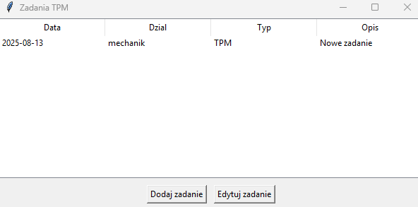
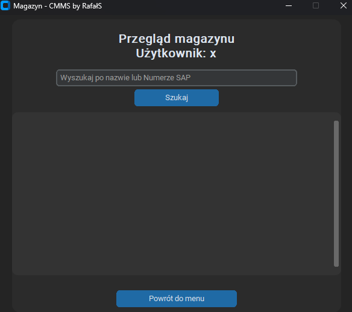

# CMMS

**CMMS** is a modern desktop **Computerized Maintenance Management System (CMMS)** application written in Python, designed to streamline maintenance management processes in industrial environments.  
It provides tools for task scheduling, failure reporting, and inventory management in one integrated, user-friendly interface.

---

## 🚀 Features

### 🔑 User Authentication
- Secure login and account creation.
- **Role-based access** to system functions: Administrator, Kierownik (Manager), Użytkownik (User) and Technik (Technician) – see [Roles](#-roles-and-permissions).
- Modern and minimal dark-themed UI for easy navigation.

### 📅 TPM Task Management
- Create, edit, and track **Total Productive Maintenance (TPM)** tasks.
- Store detailed information such as:
  - Date
  - Department
  - Task type
  - Description
- Simple, table-based task overview with quick editing options.

### ⚠ Failure Reporting
- Log and track breakdowns with detailed parameters:
  - System area, subsystem, functional subsystem
  - Date and time of failure start/end
  - Shift number
  - Downtime duration
  - Department and failure category
  - Failure type and description
- Failure workflow with statuses: **Zgłoszona → W naprawie → Rozwiązana** (users report, technicians take over and close failures; downtime and costs are calculated on closing).
- Integrated failure history view for easy reference.

### 📦 Inventory Management
- Search spare parts by **name** or **SAP number**.
- View warehouse stock in a clean, scrollable list.
- Supports quick lookup for maintenance tasks.

---

## 🔐 Roles and permissions

| Role | Access |
|---|---|
| **Administrator** | all functions, including user rates and role assignment |
| **Kierownik** (Manager) | reports and visualizations (Statystyki) |
| **Użytkownik** (User) | reporting failures |
| **Technik** (Technician) | resolving failures, updating state (Zatwierdź TPM) and the warehouse (Magazyn) |

The whole permission matrix lives in [`permissions.py`](permissions.py). The first account created in an empty database becomes Administrator; all other new accounts start as *Użytkownik*. Setup, pgAdmin 4 instructions and troubleshooting (in Polish): [`URUCHOMIENIE.md`](URUCHOMIENIE.md).

---

## 🖥 Screenshots

**Login Screen**  

**TPM Task Overview**  

**Failure Reporting**  

**Inventory View**  

**Menu View**  

---

## 🛠 Technology Stack

- **Language:** Python 3.x  
- **GUI Framework:** [customtkinter](https://github.com/TomSchimansky/CustomTkinter)  
- **Database:** PostgreSQL ([psycopg2](https://www.psycopg.org/); connection settings in `data.env`, see `data.env.example`)  
- **Platform:** Windows (tested), cross-platform compatible with Python & tkinter  
- **Version Control:** GitHub  

---

## 📂 Project Structure

CMMS/  
│  
├── LICENSE # Project license  
├── README.md # Project documentation  
├── URUCHOMIENIE.md # Setup guide, roles, pgAdmin 4 (Polish)  
├── requirements.txt # Python dependencies  
├── data.env.example # Database connection template  
├── cmms.db # Old SQLite file (no longer used)  
│  
├── sql/001_add_roles.sql # Roles + failure status migration (run in pgAdmin 4)  
├── permissions.py # Roles and permission matrix  
├── db_utils.py # Database operations  
├── failure_report.py # Failure reporting logic  
├── failure_window.py # Failure reporting UI  
├── failure_resolve_window.py # Technician UI: repair queue  
├── inventory_view.py # Inventory list display  
├── inventory_window.py # Inventory search UI  
├── login_window.py # Login window  
├── main.py # Application entry point  
├── main_menu.py # Main navigation menu  
├── print_tasks_window.py # Print TPM tasks window  
├── register_window.py # User registration window  
├── setup_db.py # Database initialization (calls db_utils.create_tables)  
├── tasks_window.py # TPM task management UI  
└── tpm_module.py # TPM task handling logic  

## 👥 Authors

- **Rafał Sak** – Project creator, Python developer, UI design, database architecture  
  GitHub: [RafalSa](https://github.com/RafalSa)  
- **Paweł Przybyła** - Database administrator, Python developer
- GitHub: [Alien-1337](https://github.com/Alien-1337)
---

## 📜 License

This project is licensed under the **MIT License**.  
You are free to use, modify, and distribute this software for personal and commercial purposes, provided that the original author is credited.
